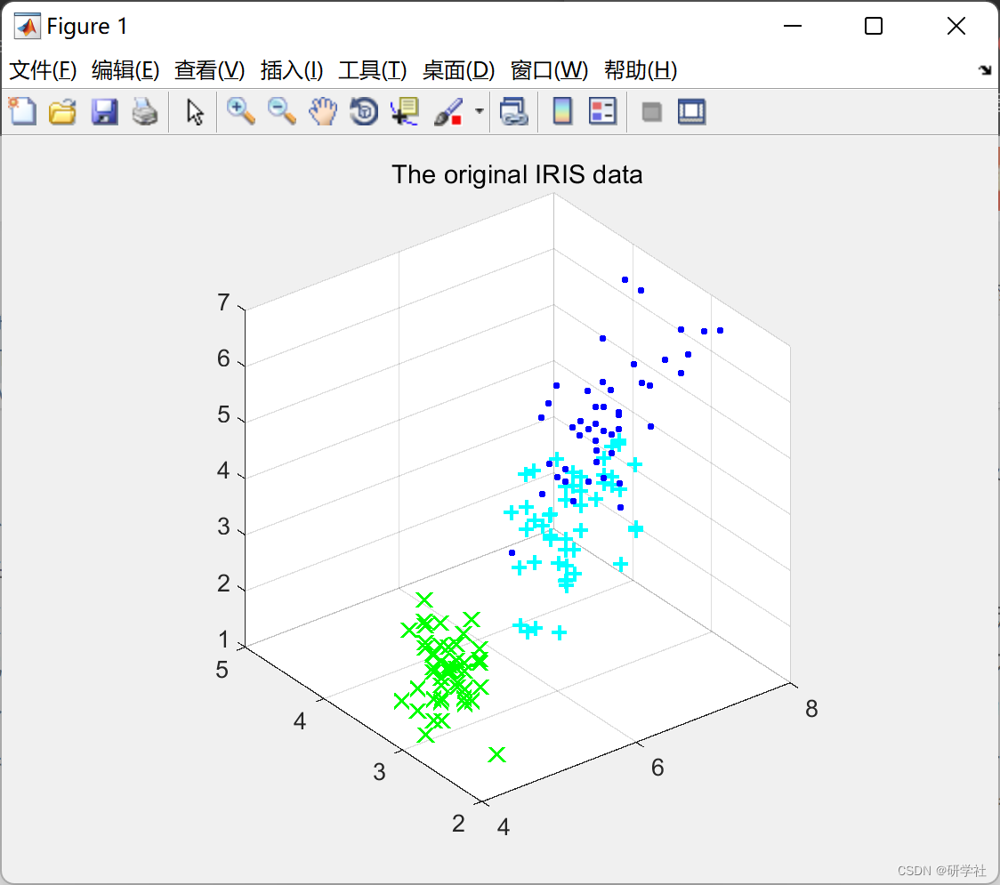
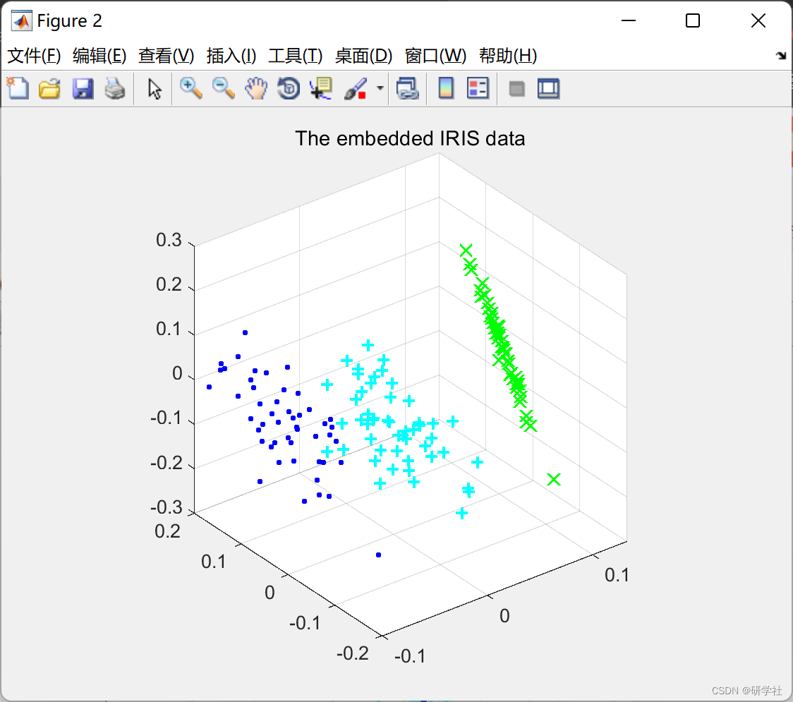

# Semi-Supervised and Unsupervised Extreme Learning Machines (SS-US-ELM) (Matlab Code Implementation)

🏆 Bloggers' Advantages: 🌞🌞🌞 The content of the blog is assiduously thought-provoking, with clear logic for the convenience of readers.
⛳️ Mantra: A journey of a thousand miles begins with a single step. 📜 1 Overview📚 2 Run results🎉 3 References🌈 4 MATLAB Code Implementation  
Editor
The Elliptic Least Squares (ELM) has been proven to be an efficient learning mechanism for pattern classification and regression. However, ELM is mainly applied in supervised learning problems. Only a few existing research papers have used ELM to explore unlabeled data. In this paper, we extend ELM to semi-supervised and unsupervised tasks based on manifold regularization, thus greatly expanding the applicability of ELM. The main advantages of the proposed algorithm are: 1) Both semi-supervised ELM (SS-ELM) and unsupervised ELM (US-ELM) exhibit the learning capability and computational efficiency of ELM; 2) Both algorithms naturally handle multi-class classification or multi-cluster clustering; 3) Both algorithms are inductive, directly processing invisible data at test time. Moreover, this paper shows that all supervised, semi-supervised, and unsupervised ELM can be placed into a unified framework. This provides a new perspective for understanding the mechanism of random feature mapping, a key concept in ELM theory. Empirical studies on various datasets indicate that the proposed algorithm is competitive in terms of accuracy and efficiency compared to state-of-the-art semi-supervised or unsupervised learning algorithms.
📚 2 Run Results 📜
Editor
Part of the code:
function [P_cond,stepnum] = step1(P_cond)  
P_size = length(P_cond);  
% Loop through each row  
for ii = 1:P_size  
rmin = min(P_cond(ii,:));  
P_cond(ii,:) = P_cond(ii,:)-rmin;  
end  
stepnum = 2;
%**************************************************************************  
% STEP 2: Find a zero in P_cond. If there are no starred zeros in its  
%     column or row start the zero. Repeat for each zero  
%**************************************************************************  
function [r_cov,c_cov,M,stepnum] = step2(P_cond)  
% Define variables  
P_size = length(P_cond);  
r_cov = zeros(P_size,1); % A vector that shows if a row is covered  
c_cov = zeros(P_size,1); % A vector that shows if a column is covered  
M = zeros(P_size);    % A mask that shows if a position is starred or primed  
for ii = 1:P_size  
for jj = 1:P_size  
if P_cond(ii,jj) == 0 && r_cov(ii) == 0 && c_cov(jj) == 0  
M(ii,jj) = 1;  
r_cov(ii) = 1;  
c_cov(jj) = 1;  
end  
end  
end  
% Re-initialize the cover vectors  
r_cov = zeros(P_size,1); % A vector that shows if a row is covered  
c_cov = zeros(P_size,1); % A vector that shows if a column is covered  
stepnum = 3;  
%**************************************************************************  
% STEP 3: Cover each column with a starred zero. If all the columns are  
%     covered then the matching is maximum  
%**************************************************************************  
function [c_cov,stepnum] = step3(M,P_size)  
c_cov = sum(M,1);  
if sum(c_cov) == P_size  
stepnum = 7;  
else  
stepnum = 4;  
end  
%**************************************************************************  
% STEP 4: Find a noncovered zero and prime it. If there is no starred  
%     zero in the row containing this primed zero, Go to Step 5.  
%     Otherwise, cover this row and uncover the column containing  
%     the starred zero. Continue in this manner until there are no  
%     uncovered zeros left. Save the smallest uncovered value and  
%     Go to Step 6.  
%**************************************************************************  
function [M,r_cov,c_cov,Z_r,Z_c,stepnum] = step4(P_cond,r_cov,c_cov,M)  
P_size = length(P_cond);  
zflag = 1;  
while zflag  
% Find the first uncovered zero  
row = 0; col = 0; exit_flag = 1;  
ii = 1; jj = 1;  
while exit_flag  
if P_cond(ii,jj) == 0 && r_cov(ii) == 0 && c_cov(jj) == 0  
row = ii;  
col = jj;  
exit_flag = 0;  
end  
jj = jj + 1;  
if jj > P_size; jj = 1; ii = ii+1; end  
if ii > P_size; exit_flag = 0; end  
end  
% If there are no uncovered zeros go to step 6  
if row == 0  
stepnum = 6;  
zflag = 0;  
Z_r = 0;  
Z_c = 0;  
else  
% Prime the uncovered zero  
M(row,col) = 2;  
% If there is a starred zero in that row  
% Cover the row and uncover the column containing the zero  
if sum(find(M(row,:)==1)) ~= 0  
r_cov(row) = 1;  
zcol = find(M(row,:)==1);  
c_cov(zcol) = 0;  
else  
stepnum = 5;  
zflag = 0;  
Z_r = row;  
Z_c = col;  
end  
end  
end  
%**************************************************************************  
% STEP 5: Construct a series of alternating primed and starred zeros as  
%    follows. Let Z0 represent the uncovered primed zero found in Step 4.  
%    Let Z1 denote the starred zero in the column of Z0 (if any).  
%    Let Z2 denote the primed zero in the row of Z1 (there will always  
%    be one). Continue until the series terminates at a primed zero  
%    that has no starred zero in its column. Unstar each starred  
%    zero of the series, star each primed zero of the series, erase  
%    all primes and uncover every line in the matrix. Return to Step 3.  
%**************************************************************************  
function [M,r_cov,c_cov,stepnum] = step5(M,Z_r,Z_c,r_cov,c_cov)  
zflag = 1;  
ii = 1;  
while zflag  
% Find the index number of the starred zero in the column  
rindex = find(M(:,Z_c(ii))==1);  
if rindex > 0  
% Save the starred zero  
ii = ii+1;  
% Save the row of the starred zero  
Z_r(ii,1) = rindex;  
% The column of the starred zero is the same as the column of the  
% primed zero  
Z_c(ii,1) = Z_c(ii-1);  
else  
zflag = 0;  
end  
% Continue if there is a starred zero in the column of the primed zero  
if zflag == 1;  
% Find the column of the primed zero in the last starred zeros row  
cindex = find(M(Z_r(ii),:)==2);  
ii = ii+1;  
Z_r(ii,1) = Z_r(ii-1);  
Z_c(ii,1) = cindex;  
end  
end  
% UNSTAR all the starred zeros in the path and STAR all primed zeros  
for ii = 1:length(Z_r)  
if M(Z_r(ii),Z_c(ii)) == 1  
M(Z_r(ii),Z_c(ii)) = 0;  
else  
M(Z_r(ii),Z_c(ii)) = 1;  
end  
end  
% Clear the covers  
r_cov = r_cov.*0;  
c_cov = c_cov.*0;  
% Remove all the primes  
M(M==2) = 0;  
stepnum = 3;  
% *************************************************************************  
% STEP 6: Add the minimum uncovered value to every element of each covered  
%    row, and subtract it from every element of each uncovered column.  
%    Return to Step 4 without altering any stars, primes, or covered lines.  
%**************************************************************************  
function [P_cond,stepnum] = step6(P_cond,r_cov,c_cov)  
a = find(r_cov == 0);  
b = find(c_cov == 0);  
minval = min(min(P_cond(a,b)));  
P_cond(find(r_cov == 1),:) = P_cond(find(r_cov == 1),:) + minval;  
P_cond(:,find(c_cov == 0)) = P_cond(:,find(c_cov == 0)) - minval;  
stepnum = 4;  
function cnum = min_line_cover(Edge)  
% Step 2  
[r_cov,c_cov,M,stepnum] = step2(Edge);  
% Step 3  
[c_cov,stepnum] = step3(M,length(Edge));  
% Step 4  
[M,r_cov,c_cov,Z_r,Z_c,stepnum] = step4(Edge,r_cov,c_cov,M);  
% Calculate the deficiency  
cnum = length(Edge)-sum(r_cov)-sum(c_cov);  
🎉3 References
🌈4 Matlab code implementation

## Images

<!-- PAYMENT_BLOCK -->

## Get this dataset

- Payment link (Stripe): [Buy now](https://buy.stripe.com/3cs8yP7sY87d0vu9AB)
- Payment QR code: 

<!-- /PAYMENT_BLOCK -->
